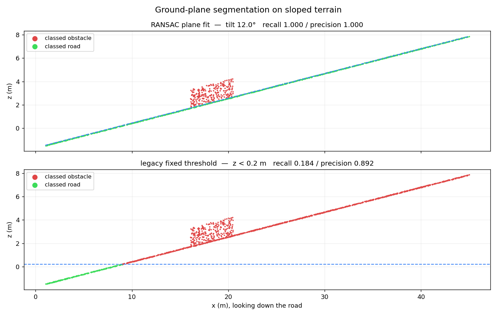

# Lane Detection PCL

**LiDAR road-surface segmentation, obstacle clustering, lane boundary fitting and grid path planning in ROS 2** — RANSAC ground plane, a tri-state inflated cost grid, and four graph searches over it, all published as RViz2/Foxglove markers.

The repo also contains two exploratory computer-vision notebooks (U-Net road
segmentation and classical edge methods). **The CV work is notebook-only: no
`.py` file imports it, it has no requirements file, dataset or entry point, and
it is not part of the `ransac_seg` ROS 2 package.** Everything else on this page
describes the ROS 2 package.

---

## Problem

Autonomous vehicles need to understand road geometry in real time. Camera-based lane detection fails in poor lighting, rain, and fog. LiDAR provides reliable 3D geometry regardless of conditions — but turning a raw point cloud into "this is the road, these are the lanes, here's a driveable path" requires multiple processing stages that are hard to prototype quickly in ROS 2.

## Solution

**LiDAR pipeline** — ROS 2 package (`ransac_seg`) takes raw `PointCloud2` data from a front-facing LiDAR and:

1. **Segments the road surface** with RANSAC plane fitting (from-scratch, in `ransac_seg/ground_plane.py`), then smooths the plane across frames
2. **Clusters the non-ground returns** into per-object boxes (voxel grid → KD-tree → connected components)
3. **Builds an inflated cost grid** from ground *and* non-ground returns: free / occupied / inflated, with cost rising near obstacles
4. **Fits the road boundaries** in the centreline frame and resamples them through a spline
5. **Plans over the cost grid** with A\*, Dijkstra and BFS, plus a DFS traversal-order baseline
6. **Publishes everything as markers**, projected onto the fitted plane rather than a flat `z = 0`

Full stage-by-stage description, module map and parameter table:
[`docs/architecture.md`](docs/architecture.md).

**Computer Vision notebooks** — exploratory, not wired into the package: a
4-way comparison of classical detectors, a U-Net trained with Dice + BCE, and
contour-based boundary extraction with Dice/IoU/Hausdorff evaluation.

---

## Demo

### Computer Vision notebooks (exploratory, not part of the ROS 2 package)

#### Detection Methods Comparison
> 4 classical CV methods evaluated on middle-strip ROI: Crop & Stretch, Canny + Hough, Adaptive Threshold, Otsu.


#### U-Net Boundary Extraction
> Input camera image → U-Net predicted mask → Track boundaries (RED = left, BLUE = right, GREEN = drivable zone).


#### Training & Evaluation
> U-Net training curves (Loss, Dice, IoU) and validation accuracy metrics (confusion matrix, Dice/IoU distributions, Hausdorff distance).

| Training History | Accuracy Metrics |
|:---:|:---:|
|  |  |

### LiDAR Pipeline

> The four RViz captures below were taken from an earlier revision of the
> pipeline, before obstacle clustering, the inflated cost grid and the
> plane-projected markers landed. They show the topics and the shape of the
> output, not the current colouring. The Foxglove path further down is the one
> to reproduce.

#### Road Surface Grid + Camera Feed
> Green grid tiles overlay the detected road surface. Front camera feed shown top-right for reference.


### A* Path Planning on Road Grid
> Cyan grid = segmented road. Yellow line = A\* shortest path from vehicle to goal.


### Lane Boundary Detection
> Left: red lane boundary curves (spline fit). Right: LiDAR point cloud with road overlay.


### Algorithm Comparison (A* / BFS / DFS)
> Three panels showing A\* (a route), BFS (a hop field) and DFS (discovery order — a baseline, not
> a planner) running simultaneously on the same grid.


---

## Quick Start

```bash
# 1. Clone into your ROS 2 workspace
cd ~/ros2_ws/src && git clone https://github.com/kekeront/lane-detection-pcl.git

# 2. Install deps + build
cd ~/ros2_ws && rosdep install --from-paths src --ignore-src -r -y && colcon build --packages-select ransac_seg

# 3. Source and launch all nodes
source install/setup.bash && ros2 launch ransac_seg algorithms.launch.py
```

Then open **RViz2** and add Marker displays for `/semantic_map/squares`,
`/semantic_map/road_left`, `/semantic_map/road_right`, `/semantic_map/road_center`
and `/planning/astar_path`, plus MarkerArray displays for
`/semantic_map/obstacles`, `/planning/dijkstra_cost`, `/planning/bfs_hops` and
`/planning/dfs_order`.

No LiDAR? [Skip to the demo](#foxglove-demo-no-lidar-required) — it needs no
hardware and no recorded data.

---

## Architecture

```
/sensor/lidar_front/points  (PointCloud2)
            │
            ▼
   vectorised decode  ──►  range gate  ──►  RANSAC ground plane
                                                    │
                                          temporal plane filter
                                                    │
                        ┌───────────────────────────┴───────────────┐
                        ▼                                           ▼
                 ground returns                            non-ground returns
                        │                                           │
             ┌──────────┴──────────┐                     obstacle clustering
             ▼                     ▼                                │
      lane boundary fit     ┌──────────────────────────┐            │
      (centreline frame)    │  tri-state cost grid     │◄───────────┘
             │              │  free / occupied /       │
             │              │  inflated + cost field   │
             │              └────────────┬─────────────┘
             │                           ▼
             │              A*   Dijkstra   BFS   DFS-baseline
             │                           │
             └───────────────┬───────────┘
                             ▼
              markers, projected onto the fitted plane
                    (RViz2 / Foxglove)
```

> Full LiDAR architecture, module map and parameter table:
> [`docs/architecture.md`](docs/architecture.md)

---

## Benchmarks on real sensor data

Two things are measured on data this package did not generate: **accuracy**
against SemanticKITTI's per-point labels, and **latency** on a recorded drive.
Everything in [Key Features](#key-features) below is synthetic and says so.

### Ground segmentation accuracy — SemanticKITTI

All 11 labelled sequences, **23 201 frames**, ~123k points each. Ground truth is
the class set the published ground-segmentation benchmarks use (`road`,
`parking`, `sidewalk`, `other-ground`, `lane-marking`, `terrain`); points
labelled `unlabeled` are excluded from scoring rather than counted as negatives.

| Configuration | IoU | precision | recall | p95 latency | frames with no plane |
|---|---|---|---|---|---|
| `distance_threshold` 0.08 — the old default | 0.620 | 0.881 | 0.676 | 34.8 ms | 1046 / 23 201 |
| `distance_threshold` 0.20 — current default | **0.808** | 0.902 | 0.886 | 29.2 ms | 0 |
| Best fixed height cut, tuned on the test set | 0.797 | — | 0.922 | — | — |

The baseline is deliberately generous: the fixed-height cut is scored at every
threshold from −2.10 m to −0.80 m and reported at whichever one wins **on the
test data itself**. No deployed system gets that. RANSAC at the tuned band beats
it by 1.1 points overall and on 7 of the 11 sequences — so the honest claim is
*on par with an oracle threshold*, not *far better than a threshold*.

The 0.08 → 0.20 change is the headline result, and it was a bug in this repo,
not a tuning knob. 0.08 m was chosen against synthetic clouds carrying 1 cm of
noise. Real Velodyne ground is spread far wider by camber, kerbs and gravel, so
the band was too tight to contain it: recall lost 21 points, and on 1046 frames
the fit failed outright and fell back to a fixed height. The replacement value
was chosen on sequences **00 and 05 only**, then reported on all eleven.

```bash
# Defaults follow the package's own distance_threshold and max_range, so this
# reproduces the 0.808 row. Pass --distance-threshold 0.08 for the 0.620 row.
python3 tools/eval_semantickitti.py --root ~/datasets/semantickitti \
    --sequences 00 01 02 03 04 05 06 07 08 09 10
```

### Pipeline latency — recorded drive

300 consecutive sweeps from a rosbag2 recording of the vehicle this package was
written for: **76 813 points** per sweep, 66 249 after the 60 m range gate.

| Stage | p50 | p95 | p99 | max |
|---|---|---|---|---|
| decode | 0.6 ms | 0.9 | 1.1 | 1.3 |
| ground segmentation | 26.1 ms | 32.5 | 36.9 | 43.5 |
| obstacle clustering | 32.0 ms | 37.6 | 41.5 | 49.3 |
| costmap + inflation | 9.8 ms | 13.1 | 15.7 | 18.7 |
| lane fit | 18.6 ms | 23.1 | 28.1 | 41.4 |
| planning (A\*, Dijkstra fallback) | 6.5 ms | 87.3 | 99.0 | 117.9 |
| **sum of p50** | **93.6 ms** | | | |

A 10 Hz sensor allows 100 ms per sweep, so the median frame fits — but the
planner's tail does not: its p95 is 87 ms on its own, because a frame whose
requested goal is unreachable pays for a full Dijkstra field before falling
back. Routes are produced on **281 of 300** frames (142 to the requested goal,
139 via the fallback); 19 frames yield no start cell at all.

```bash
python3 tools/bench_rosbag.py path/to/recording.mcap --frames 300
```

There are no accuracy numbers for this recording. It carries no ground-truth
labels, so any correctness figure quoted from it would be invented.

---

## Key Features

Every figure below was measured on a **synthetic** cloud, and every one of them
is reproduced by a single command:

```bash
python3 tools/benchmarks.py                       # all sections
python3 tools/benchmarks.py --section segmentation
```

That script defines each scene in full and prints the numbers quoted here, so a
figure that drifts shows up as a diff. No number here comes from a real sensor.
The values below are one run on one machine; the timings will differ on yours,
the accuracy figures will not.

### LiDAR (ROS 2)
- **RANSAC ground-plane segmentation** — from-scratch estimator (`ground_plane.py`): adaptive
  iteration budget from the inlier ratio, degenerate-sample rejection, a tilt gate so walls and
  vehicle flanks can't win over the road, and an SVD total-least-squares refit on the consensus set.
  On a synthetic 120k-point cloud with a 10° slope and 35 % non-ground returns it recovers the
  surface at **recall 1.000 / precision 1.000 in 16.0 ms**; the fixed `z < 0.2` cut on the same
  cloud manages **0.717 / 0.744**, because at 10° the road climbs past 0.2 m within ~11 m of the
  sensor. Falls back to the height filter (and warns) when no plane clears the inlier floor.
- **Vectorised decode** — `cloud_io.pointcloud2_to_xyz` reads a 120k-point cloud in **1.6 ms**
  against **206 ms** for the per-point `read_points` loop the nodes used to carry (identical
  output, max abs difference 0)
- **Temporal plane filter** — blends the plane across frames and rejects tilt/offset jumps, holding
  the last good plane through a bounded run of failures
- **Obstacle clustering** — voxel grid → KD-tree radius pairs → connected components; on a synthetic
  three-parked-cars scene, **3 clusters from 2700 non-ground returns in 5.2 ms**, recovered extents
  4.19 × 1.80 m against 4.20 × 1.80 m planted
- **Inflated cost grid** — free / occupied / inflated states plus a float32 cost field from a
  distance transform in metres; **2.7 ms** for an 81 × 19 grid on that scene (1132 free / 108
  occupied / 51 inflated / 248 unknown, free-cell cost 1.000–1.870). Clearance is measured to the
  obstacle *return*, not to its cell centre: the transform is shortened by half a cell diagonal, so
  a cell left FREE really is `robot_radius` clear of the geometry
- **Lane boundaries in the centreline frame** — PCA seed, median-refit centreline, percentile edges
  per arc-length bin, spline resample. On a synthetic straight 7.00 m road the median fitted width
  is **6.713 m**; on a 6.00 m road curving at R = 60 m it is **5.749 m**. Both match the estimator's
  own estimand (percentile edges are inset by construction: a uniform-density road reads
  `width × (1 − 2 × 0.02)`, i.e. 6.720 m and 5.760 m) to within 0.007 m and 0.011 m.
- **3 planners + 1 baseline over the cost grid** — A\* (octile heuristic, 8-connected), Dijkstra
  (cost field from the ego origin), BFS (hop field), and DFS as a *traversal-order baseline*: it
  reaches the identical cell set BFS reaches (measured: 1132 = 1132) and produces no path and no
  cost. A\*'s total path cost and Dijkstra's cost at the same goal agree exactly (39.000000 vs
  39.000000). 8-connected steps refuse to cut the corner between two blocked cells, so a diagonal
  wall is a wall.
- **Single launch file** — `ros2 launch ransac_seg algorithms.launch.py` starts all six nodes
- **Offline data path** — KITTI `.bin` / `.pcd` readers and a rosbag2 replayer feed the same nodes

### Computer Vision (notebooks only — not imported by any `.py`, no entry point)
- **4 classical detection methods** — compared side-by-side on middle-strip ROI
- **U-Net segmentation** — trained with Dice + BCE combined loss, mixed-precision (FP16)
- **Contour-based boundary extraction** — left/right edge + drivable zone from predicted masks
- **Quantitative evaluation** — Dice, IoU, Hausdorff distance, confusion matrix on validation set

---

## ROS 2 Topics

### Subscribed

| Topic | Type | Description |
|-------|------|-------------|
| `/sensor/lidar_front/points` | `sensor_msgs/PointCloud2` | Raw LiDAR point cloud |

### Published

| Topic | Type | Published by | Description |
|-------|------|--------------|-------------|
| `/semantic_map/squares` | `visualization_msgs/Marker` | `ransac_node` | Cost-grid cells, namespaces `ground` / `obstacles` / `inflation` (CUBE_LIST) |
| `/semantic_map/obstacles` | `visualization_msgs/MarkerArray` | `ransac_node` | One box per clustered obstacle |
| `/semantic_map/road_left` | `visualization_msgs/Marker` | `curve` | Left road boundary (LINE_STRIP) |
| `/semantic_map/road_right` | `visualization_msgs/Marker` | `curve` | Right road boundary (LINE_STRIP) |
| `/semantic_map/road_center` | `visualization_msgs/Marker` | `curve` | Centreline the edges were measured against |
| `/planning/astar_path` | `visualization_msgs/Marker` | `astar` | Least-cost route from the ego origin (LINE_STRIP) |
| `/planning/dijkstra_cost` | `visualization_msgs/MarkerArray` | `dijkstra` | Accumulated traversal cost from the ego origin, in colour bands |
| `/planning/bfs_hops` | `visualization_msgs/MarkerArray` | `bfs` | 4-connected hop count from the ego origin, in colour bands |
| `/planning/dfs_order` | `visualization_msgs/MarkerArray` | `dfs` | Depth-first discovery order, in colour bands |

Cost, hop and order fields are quantised into `field_bands` (default 6) colour
levels; the exact per-cell values appear only in the throttled log lines.

### Nodes

| Executable | Node name | Class |
|---|---|---|
| `ransac_node` | `ground_segmentation_node` | `GroundSegmentationNode` |
| `curve` | `lane_boundary_node` | `LaneBoundaryNode` |
| `astar` | `astar_planner_node` | `AStarPlanner` |
| `dijkstra` | `dijkstra_planner_node` | `DijkstraPlanner` |
| `bfs` | `bfs_planner_node` | `BFSPlanner` |
| `dfs` | `dfs_baseline_node` | `DFSBaseline` |

### Parameters

All 24 shared parameters (topics, QoS, grid resolution, inflation, the whole
RANSAC configuration, the plane filter) are declared on **every** node by
`ransac_seg/params.py`, alongside per-node clustering, lane and planner
tunables. The full table with defaults is in
[`docs/architecture.md`](docs/architecture.md#parameters). Override any of them
the usual way:

```bash
ros2 run ransac_seg astar --ros-args -p goal_x:=30.0 -p connectivity:=4
ros2 launch ransac_seg algorithms.launch.py input_topic:=/lidar/points resolution:=0.25
```

Twenty-one of the shared parameters are also **live** — `ros2 param set` on a
running node takes effect from the next sweep:

```bash
ros2 param set /ground_segmentation_node resolution 0.25
```

The three consumed while the node is built (`input_topic`, `marker_topic`,
`qos_depth`) and the node-specific tunables are **refused with a reason**
rather than acknowledged and quietly ignored; restart the node to change them.

---

## Project Structure

```
lane-detection-pcl/
├── ransac_seg/                          # ROS 2 LiDAR pipeline
│   ├── cloud_io.py                      # PointCloud2 <-> numpy, both directions vectorised
│   ├── ground_plane.py                  # RANSAC plane fitting (numpy, no ROS deps)
│   ├── plane_filter.py                  # Temporal smoothing / jump rejection of the plane
│   ├── cluster.py                       # Obstacle clustering (voxel + KD-tree + components)
│   ├── grid.py                          # Tri-state inflated cost grid
│   ├── lane.py                          # Road boundary fit in the centreline frame
│   ├── planners.py                      # A*/Dijkstra/BFS/DFS over the cost grid (no ROS)
│   ├── markers.py                       # Marker constructors (empty geometry -> DELETEALL)
│   ├── params.py                        # The 24 shared ROS parameters and their types
│   ├── perception_node.py               # PerceptionNode base every node subclasses
│   ├── point_files.py                   # KITTI .bin / .pcd readers
│   ├── ransac_node.py                   # Ground + obstacle + inflation visualiser
│   ├── curve.py                         # Lane boundary node
│   ├── astar.py, dijkstra.py            # Planner nodes
│   └── bfs.py, dfs.py                   # Reachability node and traversal-order baseline
├── test/                                # 147-case suite; ~120 cases need no ROS install
│   ├── test_ground_plane.py             # RANSAC: slope, walls, degenerate input, determinism
│   ├── test_grid.py, test_planners.py   # Cost grid and the four searches
│   ├── test_cluster.py, test_lane.py    # Clustering and boundary fitting
│   ├── test_cloud_io.py, test_markers.py, test_plane_filter.py, test_point_files.py
│   ├── test_nodes_end_to_end.py         # All six nodes driven with real PointCloud2s
│   └── test_flake8.py, test_pep257.py, test_copyright.py   # the package's own linters
├── tools/
│   ├── foxglove_demo.py                 # Writes an MCAP of the whole pipeline + preview PNG
│   ├── demo_publisher.py                # Live synthetic stream for the real nodes
│   ├── kitti_publisher.py               # Publishes KITTI .bin / .pcd sweeps
│   ├── replay_bag.py                    # Replays a rosbag2 cloud topic into the nodes
│   └── benchmarks.py                    # Reproduces every figure quoted in this README
├── track_boundary_detection_clean.ipynb  # CV notebook (U-Net + classical) — not packaged
├── checkpoint.ipynb                      # CV baseline experiments — not packaged
├── launch/
│   └── algorithms.launch.py             # Launch all six ROS 2 nodes
├── .github/workflows/ci.yml             # Runs the suite (incl. linters) on push and PR
├── docs/
│   ├── architecture.md                  # Pipeline, modules, parameter table
│   └── screenshots/                     # Demo visualizations
├── CHANGELOG.md                         # Dated decision log with measured outcomes
├── package.xml
├── setup.py
└── setup.cfg
```

---

## Tech Stack

| Component | Technology |
|-----------|-----------|
| Middleware | ROS 2 (ament_python) |
| Language | Python 3.10+ |
| Point Cloud | sensor_msgs_py / PointCloud2 |
| Deep Learning | TensorFlow / Keras (U-Net) — notebooks only, not in the package |
| Classical CV | OpenCV (Canny, Hough, Otsu) — notebooks only, not in the package |
| Math | NumPy, SciPy |
| Visualization | RViz2 / Foxglove / Matplotlib |

---

## Dependencies

- **ROS 2** (Humble or later, `ament_python` build)
- `rclpy`, `sensor_msgs`, `sensor_msgs_py`, `std_msgs`, `visualization_msgs`, `geometry_msgs`,
  `rcl_interfaces`, `builtin_interfaces`
- `numpy`, `scipy`
- `launch`, `launch_ros` — needed by `algorithms.launch.py`
- `rosbag2_py` — bag writing (`tools/foxglove_demo.py`) and replay (`tools/replay_bag.py`)
- `matplotlib` — only for `tools/foxglove_demo.py --preview`, imported lazily
- `foxglove_bridge` — optional, only for the live Foxglove view

All of these are declared in `package.xml`, so `rosdep install` covers them.

### Tests and CI

```bash
python3 -m pytest test/ -q      # 146 passed, 1 skipped
```

The suite includes the package's own `ament_flake8` / `ament_pep257` linters, so
it is the style gate as well. `.github/workflows/ci.yml` runs exactly that
command inside a `ros:humble` container on push and pull request. **The workflow
has never executed** — there is no run history to claim a status from, which is
why there is no CI badge above.

---

## Usage

### Individual nodes

```bash
ros2 run ransac_seg ransac_node   # cost-grid cells + clustered obstacle boxes
ros2 run ransac_seg curve         # road boundaries + centreline
ros2 run ransac_seg astar         # least-cost route from the ego origin
ros2 run ransac_seg dijkstra      # accumulated traversal cost field
ros2 run ransac_seg bfs           # hop field (unweighted reachability)
ros2 run ransac_seg dfs           # traversal-order baseline (no path, no cost)
```

### All at once

```bash
ros2 launch ransac_seg algorithms.launch.py
```

### Real data: KITTI sweeps and rosbag2 replay

Both feed the same `input_topic` the nodes subscribe to, so nothing about the
pipeline changes between synthetic and recorded input:

```bash
# a directory of KITTI .bin sweeps (or .pcd files), published on a timer
python3 tools/kitti_publisher.py /path/to/velodyne/ --rate 10

# any rosbag2 recording holding a PointCloud2 topic
python3 tools/replay_bag.py /path/to/bag --in-topic /lidar/points --rate 1.0
```

`ransac_seg/point_files.py` resolves PCD fields by **name**, so a file declaring
`FIELDS z y x` reads back correctly rather than silently permuting coordinates,
and `binary_compressed` raises instead of mis-parsing. An unreadable sweep in a
directory is warned about and skipped rather than being fatal.

**No accuracy numbers have been produced from real data.** The path exists and
was exercised end to end against generated `.bin` sweeps and an MCAP bag written
by `foxglove_demo.py`; it has not been run against a recorded vehicle dataset.

### Foxglove demo (no LiDAR required)

Generates an MCAP recording of a drive along a road corridor whose slope changes
underneath the sensor, running the **whole** pipeline on every sweep —
`segment_ground`, `build_costmap`, `cluster_obstacles`, `fit_lane`, `astar` —
so the recording shows what the nodes compute:

```bash
python3 tools/foxglove_demo.py            # writes docs/ransac_demo/*.mcap
python3 tools/foxglove_demo.py --frames 20 --out /tmp/demo --preview ''
```

Open the `.mcap` in [Foxglove](https://app.foxglove.dev) and add a **3D panel**.
The marker topics and namespaces are the ones the live nodes publish, so one
layout works for the bag and for a running graph:

| Topic | What it shows |
|-------|---------------|
| `/lidar/points` | Full cloud, green = road / red = obstacle **as classified by RANSAC** |
| `/lidar/legacy_points` | Same cloud classified by the old `z < 0.2` filter |
| `/ransac/plane` | The fitted plane as a translucent quad |
| `/ransac/stats` | Per-frame tilt, inliers, recall/precision, lane width, obstacles, path length |
| `/semantic_map/squares` | Cost-grid cells: `ground`, `obstacles`, `inflation` |
| `/semantic_map/obstacles` | One box per clustered obstacle |
| `/semantic_map/road_left`, `road_right`, `road_center` | The fitted boundaries and centreline |
| `/planning/astar_path` | The least-cost route across the cost grid |

Scrub the timeline: as the slope steepens the RANSAC plane tracks it, while the
fixed threshold progressively misclassifies the road as obstacle. Measured over
a 20-frame synthetic run this session — **RANSAC mean recall 1.000 / precision
1.000, legacy `z < 0.2` 0.437 / 0.753**, 0 fallback frames, a lane fitted on
20/20 frames at median width 8.61 m (the corridor is 9.00 m wide and percentile
edges are inset by construction), 2.6 obstacle clusters per frame, and a route
planned on 20/20 frames at median cost 24.3. The legacy figure differs from the
0.717 quoted under Key Features because this is a different scene — a 9 m road
corridor whose slope changes across the run, not the 120k flat-slope cloud.

### Live in Foxglove (no LiDAR either)

Streams the same scene into the real nodes instead of a file, so every node runs
unmodified and publishes its markers live:

```bash
ros2 launch foxglove_bridge foxglove_bridge_launch.xml   # shell 1
python3 tools/demo_publisher.py                          # shell 2
ros2 launch ransac_seg algorithms.launch.py              # shell 3
```

Connect Foxglove to `ws://localhost:8765` (Open Connection → Foxglove
WebSocket), or open the deep link directly:

```bash
xdg-open 'foxglove://open?ds=foxglove-websocket&ds.url=ws%3A%2F%2Flocalhost%3A8765'
```

`demo_publisher.py` also runs the pipeline in-process and previews it under
`/demo/...`, so it is worth watching on its own; those topics are deliberately
*not* `/semantic_map/...`, because two publishers on one topic would interleave
two sources into one display. Measured this session: **55.1 ms per tick** for
scene generation plus the full pipeline plus publishing a 15k-point sweep, so
the demo's own 10 Hz default has headroom.

**The nodes do not hit 10 Hz on a real sweep.** Median `_on_cloud` cost on a
120k-point synthetic sweep (80 % ground / 20 % roadside clutter, 10° slope),
from `python3 tools/benchmarks.py --section callbacks`:

| Node | Per-sweep callback |
|---|---|
| `AStarPlanner` | 44.3 ms |
| `BFSPlanner` | 54.2 ms |
| `DFSBaseline` | 70.7 ms |
| `GroundSegmentationNode` | 104.4 ms |
| `DijkstraPlanner` | 95.0 ms |
| `LaneBoundaryNode` | 122.7 ms |

Two of the six exceed the 100 ms a 10 Hz sensor allows, and
`algorithms.launch.py` runs all six, each independently repeating decode,
`segment_ground` and `build_costmap` on the same cloud — roughly 560 ms of CPU
per 100 ms sweep. The cloud subscription is BEST_EFFORT, so a backed-up node
drops sweeps instead of falling further behind, but the published geometry is
then older than the sensor's. Treat this as a prototyping pipeline at sweep
size, not a real-time one; a shared perception node feeding the planners is the
obvious fix and is not written.



*Side view at 12° slope. Top: RANSAC follows the surface. Bottom: everything
past ~9 m sits above `z = 0.2` and is discarded as obstacle.*

---

## Limitations

- Ground-plane RANSAC assumes a sensor frame with +z roughly up (the tilt gate depends on it) and
  a single dominant surface — it will not split a road from an adjacent parallel ramp
- **Accuracy is measured on SemanticKITTI; the recorded drive has no labels.** IoU/precision/recall
  come from 23 201 labelled KITTI frames; the rosbag2 recording supplies latency and route-success
  counts only. Every figure under [Key Features](#key-features) is still synthetic
- **Free-space carving cannot see negative obstacles.** Cells the beams crossed are marked free, so
  a trench, a kerb drop or an open stairwell between the sensor and a farther ground return is
  carved drivable. Only positive obstacles — anything that produces a return — block a cell
- **Segmentation is one global plane.** On KITTI the ground classes include `sidewalk` and
  `terrain`, which are not coplanar with the road; the fit underfits them by construction, which is
  most of the gap between 0.808 IoU and 1.0. Sector-wise fitting (Patchwork-style) is the fix and is
  not written
- `distance_threshold` is 0.20 m because that won on KITTI sequences 00 and 05. It is a property of
  that sensor and that ground; a different LiDAR will want a different band, and there is no
  auto-tuning
- No ego-motion or odometry input, so the cost grid is **single-frame**: it is rebuilt from scratch
  on each sweep and nothing is accumulated or tracked between them
- Planning is a search over an inflated occupancy cost grid built from ground and non-ground
  returns. It is **not** an obstacle-avoidance layer and is **not** safety-usable: there is no
  kinematic model, no dynamic obstacle handling, no time dimension and no controller
- Reported lane widths are biased low by twice `lane_edge_percentile` of the width — a property of
  the percentile-edge estimator, not an error. Quote the estimand, not the nominal road width
- Lane boundary fitting assumes a single road corridor (no intersections) and a centreline that a
  degree-2 polynomial can represent; past roughly a 90° bend the fit stays finite but reports
  `width_out_of_range`
- DFS is a traversal-order baseline, not a planner: it reaches exactly the cell set BFS reaches and
  produces no path and no cost
- **Not real-time at sweep size.** Two of the six nodes exceed the 100 ms a 10 Hz sensor allows on
  a 120k-point cloud (table above), and the launch file runs all six, each repeating the same
  decode / segment / rasterise work. A shared perception node is the fix and is not written
- `tools/foxglove_demo.py`'s frame averages have no test coverage

---

## Roadmap

- [x] Replace Z-threshold with RANSAC plane fitting for robust segmentation
- [x] Add obstacle point clustering
- [x] Weighted grid costs (obstacle-proximity inflation) shared by all planners
- [x] Ingestion path for KITTI sweeps and rosbag2 recordings
- [x] Validate against real data and publish the numbers (SemanticKITTI accuracy, rosbag latency)
- [ ] Sector-wise plane fitting, so `sidewalk` and `terrain` stop fighting one global plane
- [ ] Bound the planner's tail: its p95 is 87 ms because an unreachable goal costs a full Dijkstra
- [ ] Accumulate the cost grid across frames using odometry
- [ ] Support for multi-lane detection and intersections
- [ ] Integration with `nav2` for full autonomous navigation stack

---

## License

This project is licensed under the **GNU General Public License v3.0**. See [LICENSE](LICENSE) for details.
